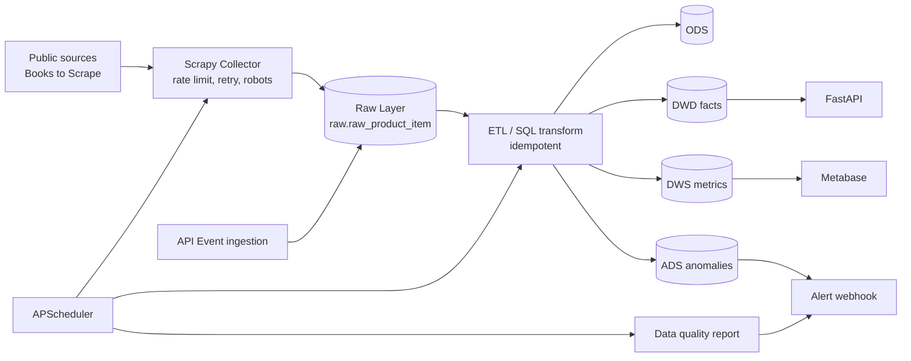

# Architecture

## Layers

| Layer | Purpose | Pattern |
|---|---|---|
| Raw | Immutable source evidence | append-only, unique fingerprint |
| ODS | Typed and deduplicated snapshots | raw-id one-to-one |
| DIM | Product, category, date, source dimensions | slowly changing upsert |
| DWD | Atomic price snapshot facts | one row per capture |
| DWS | Daily aggregate metrics | upsert by date/product/source |
| ADS | Anomaly and business-facing tables | threshold detection |

## Runtime Components

- **collector**: Scrapy process; supports `JOBDIR` resume and AutoThrottle.
- **scheduler**: APScheduler; jobs call independent modules and can be moved to Airflow without code changes.
- **API**: FastAPI; supports near-real-time event ingestion and analytical reads.
- **MySQL**: system of record and warehouse.
- **Redis**: crawl deduplication and distributed execution lock storage.
- **Metabase**: dashboard and reporting layer with read-only database account.

## Data Governance

- `raw_payload` preserves original evidence.
- All transformations are idempotent and keyed by natural or surrogate keys.
- Secrets are environment-injected; `.env` is never committed.
- Data quality reports are stored in `reports/`.
