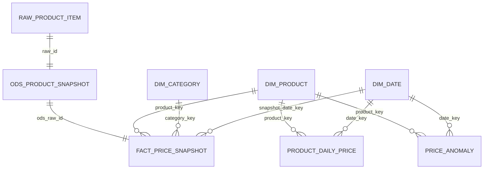

# Data Model and ER Diagram

## Grain

- `raw_product_item`: one captured source response.
- `ods_product_snapshot`: one cleaned source response.
- `fact_price_snapshot`: one product price observation.
- `product_daily_price`: one product/source/day.
- `price_anomaly`: one product/source/day when change rate is at least 5%.
